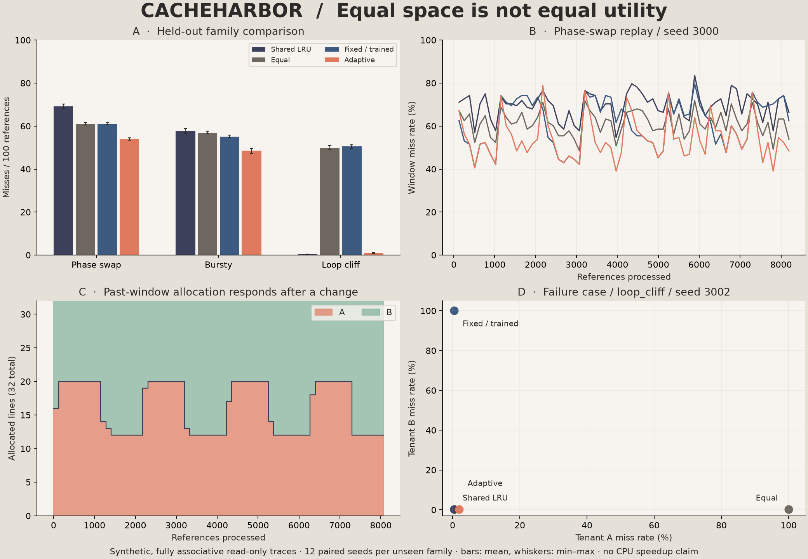
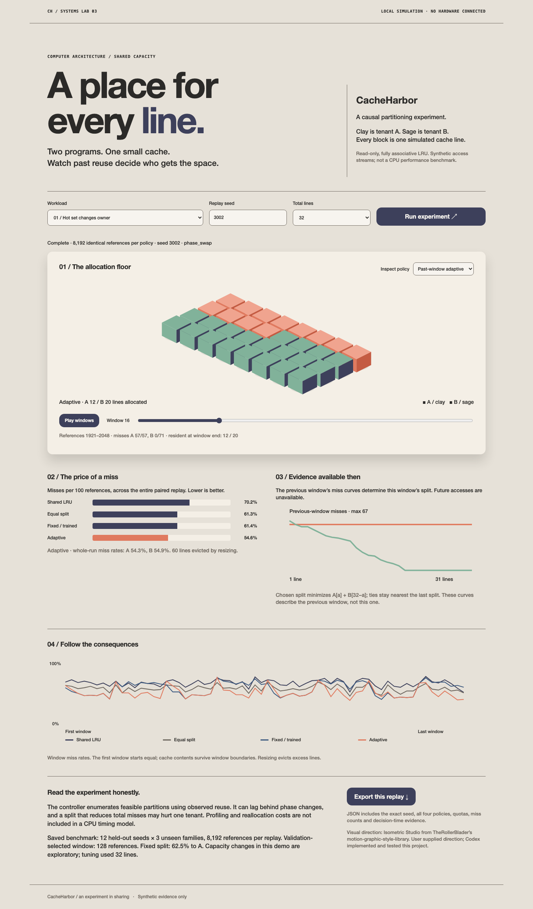

# Problem Statement

**CacheHarbor** asks: when two programs share a small cache, can allocation based only on past reuse reduce misses compared with shared LRU and equal partitions? Inputs are reproducible synthetic access streams and a fixed line budget; outputs are paired miss rates, tenant outcomes, allocation histories and decision-time evidence. Success means fewer held-out misses under identical references and capacity, with failures reported. This is a read-only, fully associative simulation—not a CPU or silicon benchmark.



## Run locally

Python 3.11+; verified locally with Python 3.14. Runtime has **no third-party dependencies**, paid APIs, datasets or hardware requirements.

```bash
git clone https://github.com/mirmoosa1014-rgb/cacheharbor.git
cd cacheharbor
python3 -m venv .venv
source .venv/bin/activate
python -m cacheharbor.server
```

Open **http://127.0.0.1:8767**. The repository does not host a live public app. Saved examples and benchmark configuration are included. Stop with Ctrl+C.

## Four ways to share

- **Shared LRU:** one namespaced cache with no quotas.
- **Equal:** fixed half-and-half partitions.
- **Fixed / trained:** a fixed fraction selected on training traces, with no test leakage.
- **Adaptive:** exact enumeration using the previous window's measured miss curves; stable ties favor the current split.

The adaptive controller is interpretable optimization, not a neural model. A tiny decision space does not justify adding ML; see [decision model](docs/model.md).

## Measured findings

| Held-out family | Shared LRU | Equal | Fixed | Adaptive |
|---|---:|---:|---:|---:|
| phase_swap | 69.20% | 60.93% | 61.13% | 53.95% |
| bursty | 57.73% | 56.97% | 55.02% | 48.59% |
| loop_cliff | 0.37% | 49.88% | 50.49% | 0.94% |

Mean miss rates over 12 seeds per unseen family, 8192 references and 32 lines. Adaptive improves on equal for these workloads; shared LRU wins the loop-cliff workload. The selected past window is 128 references and the fixed fraction is 62.5% to A. See [protocol, counterexample and limitations](docs/evaluation.md), [raw paired results](results/paired.csv), and [configuration](results/benchmark.json).

## The interactive exhibit



Scrub or play allocation windows, compare policies, inspect prior-window evidence, change workload/seed/capacity, and export the actual replay. Tenant labels and numeric summaries accompany color; keyboard controls, narrow screens and reduced motion are supported. [90-second walkthrough](docs/demo.md) · [mobile screenshot](docs/images/demo-mobile.png).

## Verify and reproduce

```bash
python -m unittest discover -s tests -v
python -m cacheharbor.experiment --quick --output results/quick
python -m cacheharbor.experiment  # full; replaces saved benchmark evidence
```

Tests cover independent LRU/profile equivalence, capacity and accounting, causal prefix invariance, deterministic replay, split separation, invalid input, API behavior, concurrency and request timeouts.

Optional browser verification (Node 22+):

```bash
npm ci
npx playwright install chromium
# Start python -m cacheharbor.server in another terminal.
npm run test:browser
```

The app uses browser-native JavaScript/SVG and needs no frontend build. Browser verification exercises replay, policy switching, evidence scrubbing, exports, pending/failure handling, recovery and mobile layout. GitHub Actions runs Python tests, the quick experiment and Chromium checks with read-only repository permissions.

Optional figure reproduction, in a separate environment:

```bash
python -m pip install -r requirements-figures.lock
python scripts/figures.py
```

The plot script reads saved experiment outputs only. See [architecture](docs/architecture.md), [plain-language explanation](docs/explain.md), and [project summary](docs/project-summary.md).

## Limits and attribution

All workloads are synthetic. The simulation omits cache-set conflicts, writes/coherence, prefetch, CPU timing, power and hardware implementation overhead. Miss-rate reductions are not speedup claims. No physical hardware was built or tested.

The user supplied project and portfolio direction. Codex selected the scoped idea, implemented the code, ran validation and prepared the documentation and figures. Inspiration: [Qureshi and Patt's utility-based partitioning report](https://hps.ece.utexas.edu/pub/TR-HPS-2006-009.pdf). Visual direction: [Isometric Studio, motion-graphic-style-library](https://github.com/TheRollerBlader/motion-graphic-style-library). This is an educational adaptation, not a reproduction of the paper's hardware or reported numbers. MIT licensed.
